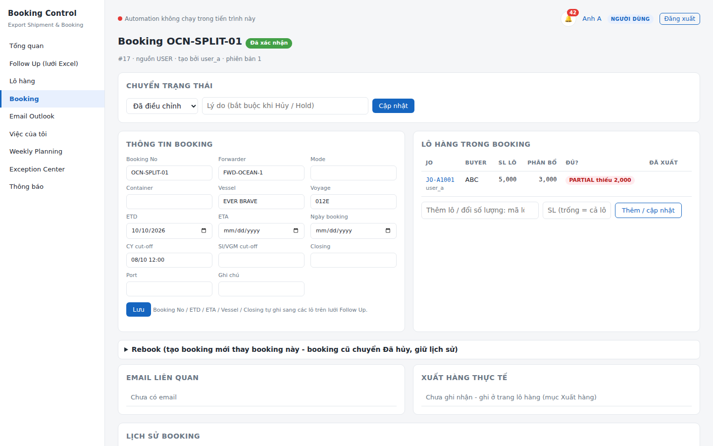
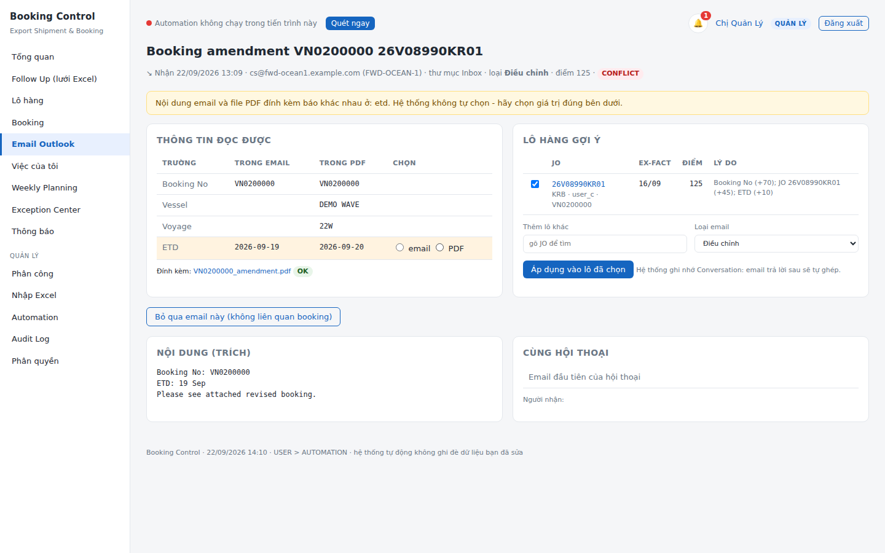
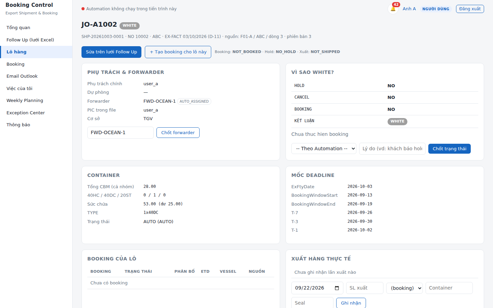
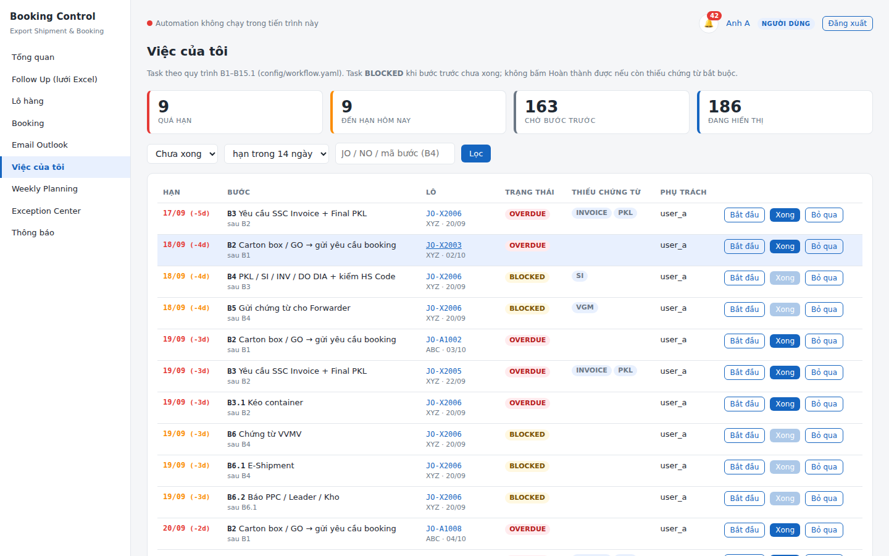

# Booking Control

**Web nội bộ quản lý Export Shipment & Booking** cho bộ phận logistics xuất khẩu — thay cho việc mỗi người tự theo dõi một file Excel Follow Up.

- Lưới **Follow Up 47 cột giống hệt file Excel** (sửa trực tiếp, dán từ Excel, kéo điền, lọc, sắp xếp, cố định cột, công thức NO / 95% FOB / CDF AMOUNT / TSN AMOUNT tính đúng như Excel), phân trang phía máy chủ.
- **Phân quyền** Quản trị / Quản lý / Người dùng / Chỉ xem / **Kiểm soát (Auditor)** — quyền kiểm tra ở backend, có trang ma trận quyền.
- **Quản lý phân công** lô hàng cho từng người phụ trách (giao lẻ, giao hàng loạt, người dự phòng, lịch sử).
- **Booking tách riêng khỏi lô hàng** *(v3)*: 1 lô nhiều booking (split 600 + 400 = 1000), nhiều lô một booking (gộp), Hold / Giải tỏa / Trễ lịch / Hủy / **Rebook giữ lịch sử**, ghi nhận **xuất một phần** theo số lượng thực tế.
- **Email Outlook desktop** *(v3)*: đọc Inbox + Sent Items trên máy chủ, phân loại (xác nhận / điều chỉnh / hủy / hold…), đọc **PDF booking confirmation** đính kèm, ghép lô theo **Conversation + điểm tin cậy**; đủ điểm thì tự cập nhật, còn lại vào **hàng chờ duyệt**; email ≠ PDF thì bắt người dùng chọn.
- **Chứng từ có version + Document Matrix** *(v3)*: tải lên không ghi đè bản cũ, chứng từ bắt buộc theo Mode / Buyer / Forwarder, có hạn và duyệt.
- **Quy trình B1 → B15.1** *(v3)*: task tự sinh cho từng lô, hạn theo EX-FACT / ETD, **tự hoàn thành khi hệ thống thấy bằng chứng** (có booking, đủ chứng từ, tàu chạy), trang "Việc của tôi".
- **Weekly Planning hạn 12:00 thứ 6** *(v3)*: từ thứ 5 tự ghi lô tuần sau, nhắc thứ 5 / thứ 6 08:00 / 11:00, Quản lý bấm chốt.
- **Xuất Excel** từ dữ liệu trên web: *lô của tôi* hoặc *theo bộ lọc* → mỗi Buyer một sheet, giữ đúng 47 cột và công thức.
- **Automation Engine** chạy nền trên máy chủ (không có "Bot"): quét Follow Up, tính trạng thái, nhắc deadline D-20 → D-1, phân bổ container, ghi Weekly Planning / HS Code / MM Daily / Lịch xuất hàng, đọc Outlook.

Chạy trên **một máy Windows làm máy chủ nội bộ**; đồng nghiệp mở bằng trình duyệt qua mạng LAN. Không cần Internet, không cần cài gì trên máy người dùng.


| Booking tách riêng | Email Outlook: email ≠ PDF |
|---|---|
|  |  |
| **Lô hàng: booking, xuất hàng, chứng từ, quy trình** | **Việc của tôi (B1 – B15.1)** |
|  |  |

---

## Kiến trúc một trang

```
  Trình duyệt (Chrome/Edge)          MÁY CHỦ NỘI BỘ (Windows)
  ─────────────────────────          ─────────────────────────────────────────────────
  Đăng nhập  ─────────────────────▶  Web (FastAPI) ── phân quyền ở backend ──┐
  Lưới Follow Up 47 cột ◀── JSON ──  API lưu tự động + optimistic lock      │
  Booking / Email / Việc / Weekly                                            ▼
                                     Database (SQLite / SQL Server / PostgreSQL)
                                          ▲                          │
  File Follow Up Excel (OneDrive) ──▶ Automation Engine (APScheduler)│
  Outlook desktop (Inbox + Sent) ──▶  followup_scan · outlook_scan · weekly_planning_check
  PDF booking confirmation            notification_dispatch · excel_write_retry · housekeeping
                                          │
                                          ▼
                     Weekly Planning · Custom Code · MM Daily · Lịch xuất (ghi lossless)
```

Nguyên tắc: **Database là trung tâm**, Excel chỉ còn vai trò nhập / xuất / tương thích. Thứ tự ưu tiên nguồn dữ liệu: **Người dùng / Quản lý > Email Outlook > file Excel**. Người dùng đã sửa tay thì email không ghi đè (báo EX020); file Excel đổi khác giá trị web thì giữ giá trị web và đưa vào Exception Center. Booking không bao giờ bị xóa; trạng thái Booking / Hold / Xuất hàng là ba cột riêng, màu dòng chỉ là lớp hiển thị.

---

## Tính năng theo vai trò

| | Quản trị | Quản lý | Người dùng | Chỉ xem | Auditor |
|---|:-:|:-:|:-:|:-:|:-:|
| Xem lô hàng, booking, task | tất cả | tất cả | lô được giao | tất cả | tất cả |
| Sửa trên lưới Follow Up | ✓ | ✓ | lô được giao, theo quyền từng cột | – | – |
| Tạo / sửa / split / gộp booking, hold, hủy, rebook | ✓ | ✓ | lô được giao | – | – |
| Ghi nhận xuất hàng một phần | ✓ | ✓ | lô được giao | – | – |
| Duyệt email Outlook (ghép lô, chọn giá trị) | ✓ | ✓ | email của lô mình + email chưa ghép | – | xem tất cả |
| Tải chứng từ / hoàn thành task | ✓ | ✓ | lô được giao | – | – |
| Duyệt / trả lại chứng từ, chốt Weekly Planning | ✓ | ✓ | – | – | – |
| Giao / giao lại / giao hàng loạt | ✓ | ✓ | – | – | – |
| Xử lý Exception, duyệt xung đột Excel ↔ web | ✓ | ✓ | – | – | – |
| Xuất Excel | tất cả / theo lọc | tất cả / theo lọc | lô của mình | tất cả / theo lọc | tất cả / theo lọc |
| Audit Log, ma trận quyền | ✓ | ✓ | – | – | ✓ |
| Nhập file Follow Up, Automation | ✓ | ✓ | – | – | – |
| Người dùng, mapping, buyer rule, cài đặt, backup | ✓ | – | – | – | – |

Quyền **từng cột** (Field Ownership Matrix) nằm trong [`config/followup_template.yaml`](config/followup_template.yaml): ví dụ Người dùng sửa được CBM, BOOKING NO, CONT, SEAL…; sửa BUYER / EX-FACT DATE thì được nhưng tạo mục "Quản lý xem lại"; cột công thức chỉ xem; NO chỉ Quản lý được ghi đè.

---

## Cài đặt nhanh (Windows)

Chép thư mục mã nguồn vào `C:\Tools\booking-control`, rồi mở PowerShell:

```powershell
cd C:\Tools\booking-control
Set-ExecutionPolicy -Scope Process -ExecutionPolicy Bypass
.\scripts\install.ps1            # tạo .venv, cài thư viện, tạo config, tạo Admin, dữ liệu demo
.\scripts\run.bat run            # chạy web + Automation
```

Mở <http://127.0.0.1:8765>, đăng nhập `admin`. Muốn đồng nghiệp dùng chung: đặt `web.host: "0.0.0.0"`, chạy `.\scripts\open_firewall.ps1` (quyền Administrator), gửi họ địa chỉ `http://<IP-máy-chủ>:8765`.

Chi tiết từng bước, cấu hình file Excel thật, chạy nền khi khởi động Windows, sao lưu: **[docs/INSTALL.md](docs/INSTALL.md)**.

---

## Tài liệu

| Tài liệu | Dành cho |
|---|---|
| [SPECIFICATION.md](docs/SPECIFICATION.md) | **Đặc tả hệ thống**: nguyên tắc nền, đối tượng nghiệp vụ, quy tắc màu / deadline / container / công thức, 5 bảng quy tắc, phân quyền, giới hạn đã biết, tiêu chí nghiệm thu |
| [INSTALL.md](docs/INSTALL.md) | Cài đặt, chạy, tài khoản, trỏ file Excel thật, máy chủ LAN, chạy nền, cấu hình chi tiết, sao lưu, nâng cấp, khắc phục sự cố |
| [USER_GUIDE.md](docs/USER_GUIDE.md) | Người dùng & Quản lý: một ngày làm việc, lưới Follow Up, gõ công thức, booking, nhóm lô xuất, email Outlook, chứng từ, phân công, nhập/xuất Excel, hỏi nhanh |
| [DEVELOPER_GUIDE.md](docs/DEVELOPER_GUIDE.md) | Lập trình viên: cấu trúc mã, thêm cột / công thức / quyền / job, test, đóng gói |
| [ARCHITECTURE.md](docs/ARCHITECTURE.md) | Kiến trúc, database, các quyết định thiết kế |
| [DATA_MAPPING.md](docs/DATA_MAPPING.md) | 47 cột Follow Up ↔ trường chuẩn ↔ file đích |
| [SRS_TRACEABILITY.md](docs/SRS_TRACEABILITY.md) | Đối chiếu từng yêu cầu SRS ↔ mã nguồn ↔ test |

---

## Dòng lệnh

```powershell
.\scripts\run.bat run                      # web + Automation (chế độ hằng ngày)
.\scripts\run.bat run --host 0.0.0.0       # mở cho mạng LAN
.\scripts\run.bat check                    # kiểm tra file, nhận diện sheet, mapping cột
.\scripts\run.bat scan --dry-run           # xem trước một lần quét, không ghi file
.\scripts\run.bat user add nam.nguyen --role manager
.\scripts\run.bat user passwd nam.nguyen   # đặt lại mật khẩu
.\scripts\run.bat user list
.\scripts\run.bat backups F02              # liệt kê / khôi phục bản sao lưu file đích
.\scripts\run.bat outlook                  # đọc Outlook ngay (máy chủ có Outlook desktop)
.\scripts\run.bat outlook --demo           # nạp 5 email mẫu để thử hàng chờ duyệt (không cần Outlook)
```

---

## Nhập dữ liệu từ file Excel ngoài

Ngoài file Follow Up theo khung 47 cột, hệ thống nhận **file Excel bất kỳ** — ví dụ *Shipment schedule* hàng trăm cột do phần mềm khác xuất ra.

Vào **Quản lý › Nhập Excel ngoài**, rồi:

1. **Tải file lên** — hệ thống liệt kê sheet và tự đoán dòng tiêu đề.
2. **Chọn cột** — bảng hiện **tất cả** cột kèm tỷ lệ ô có dữ liệu và vài giá trị mẫu, nên bạn nhìn thấy ngay cột nào thật sự chứa cái mình cần (nhiều file có tiêu đề lệch so với dữ liệu bên dưới). Hệ thống gợi ý ánh xạ và chỉ tự tick khi chắc chắn từ 90% trở lên — còn lại bạn quyết định. Bắt buộc chọn **JO**, **EX-FACT DATE**, **BUYER**.
3. **Xem trước** — bao nhiêu dòng thêm mới / cập nhật / bỏ qua và vì sao (ô `#REF!`, thiếu JO…).
4. **Nhập** — và lưu lại thành **bộ map** để lần sau chỉ cần chọn tên bộ map.

Cột không chọn thì hệ thống không đọc tới. File gốc không bị sửa.

---

## Công thức trên lưới

Cột công thức khai báo sẵn trong [`config/followup_template.yaml`](config/followup_template.yaml), và **người dùng gõ thẳng công thức vào ô** như Excel:

```
=ROUND(W*0.95,2)          tham chiếu bằng chữ cột, cùng dòng
=ROUND([Price]*0.95,2)    hoặc bằng tên cột
=IF([FinalCBM]>15,"FCL","LCL")
=SUM(N:Q)                 cộng nhiều cột trong CÙNG một dòng
```

Hàm hỗ trợ: IF, IFERROR, AND, OR, NOT, SUM, MIN, MAX, AVERAGE, COUNT, COUNTA, ROUND, ROUNDUP, ROUNDDOWN, INT, ABS, MOD, POWER, SQRT, CEILING, FLOOR, LEN, LEFT, RIGHT, MID, TRIM, UPPER, LOWER, CONCAT, VALUE, ISBLANK, ISNUMBER, TODAY, DATE, YEAR, MONTH, DAY, DAYS.

Một công thức được phân tích **một lần** thành cây, rồi Python (máy chủ), JavaScript (lưới) và file Excel xuất ra cùng đọc cây đó — nên ba nơi luôn cho cùng kết quả, kể cả cách làm tròn 0,5. Trình duyệt không `eval()` gì cả. Công thức **chỉ tính trong một dòng**; tổng theo nhiều dòng xem ở thanh trạng thái dưới lưới (Tổng / TB / Nhỏ nhất / Lớn nhất của vùng đang chọn).

---

## Nhiều người dùng chung cùng lúc

- Lưới tự **kéo thay đổi của người khác về mỗi 7 giây** và tô sáng dòng vừa đổi — không phải bấm Tải lại.
- Hiện **ai đang sửa dòng nào** và bao nhiêu người đang mở trang.
- **Khóa lạc quan** theo từng dòng: gửi bản cũ thì máy chủ trả lại dòng mới thay vì ghi đè — áp dụng cho cả xung đột người ↔ Automation.
- SQLite bật WAL + `busy_timeout`, nên nhiều người ghi cùng lúc không gặp lỗi *database is locked*. Khi phòng đông hơn nữa, đổi `database.url` sang SQL Server / PostgreSQL.

---

## Công nghệ

Python 3.11 · FastAPI + Jinja2 · SQLAlchemy 2 (SQLite mặc định; SQL Server / PostgreSQL qua `database.url`) · APScheduler · openpyxl (đọc) + lxml (ghi Excel lossless, không phá công thức / định dạng / link) · Jspreadsheet CE 4 (MIT, đóng gói sẵn để chạy offline) · pywin32 (Outlook desktop qua COM) · pdfplumber (đọc chữ trong PDF) · pytest (≈260 test, chạy trên Windows + Ubuntu).

Hiệu năng (đo trên 10.000 lô, 148.000 task, SQLite): các trang web mở dưới 2 giây; đồng bộ booking + task mỗi lần quét khoảng 2–3 giây.

Vì sao không dùng Celery/Redis như SRS gợi ý: Celery không hỗ trợ Windows chính thức và cần thêm dịch vụ Redis. Với quy mô một phòng logistics (vài nghìn lô), APScheduler chạy trong tiến trình máy chủ là đủ; mỗi job vẫn có Job ID, thời gian, trạng thái, lỗi, số lần thử lại như SRS yêu cầu. Khi cần mở rộng, các job nằm gọn trong `scheduler.py` để chuyển sang hàng đợi riêng.

---

## Bảo mật & dữ liệu

- Mật khẩu băm PBKDF2-SHA256; cookie phiên `HttpOnly` + `SameSite=Lax`; CSRF token cho mọi thao tác ghi; khóa tạm khi sai mật khẩu nhiều lần.
- Phân quyền kiểm tra ở **backend** — kể cả xuất Excel (người dùng yêu cầu xuất "tất cả" vẫn chỉ nhận lô của mình).
- Không xóa dữ liệu nghiệp vụ: lô hàng chỉ **lưu trữ**, tài khoản chỉ **khóa**, booking chỉ **hủy / rebook**, chứng từ chỉ **thêm version**; mọi thay đổi vào Audit Log + dòng thời gian lô hàng (ai, lúc nào, nguồn, giá trị cũ → mới).
- Email Outlook chỉ lưu đoạn đầu nội dung + file đính kèm liên quan (PDF / Excel) trong thư mục dữ liệu máy chủ; chứng từ lưu ngoài database (có thể đặt ở ổ mạng).
- Không đưa file Excel thật / mã buyer thật vào mã nguồn chia sẻ: `config/config.yaml`, `config/buyer_rules.yaml`, `data/`, `sample_data/` đã nằm trong `.gitignore`. Dữ liệu demo hoàn toàn giả lập.

## Giấy phép

MIT — xem [LICENSE](LICENSE). Thư viện bên thứ ba đóng gói trong `web/static/vendor/` giữ giấy phép MIT gốc.
