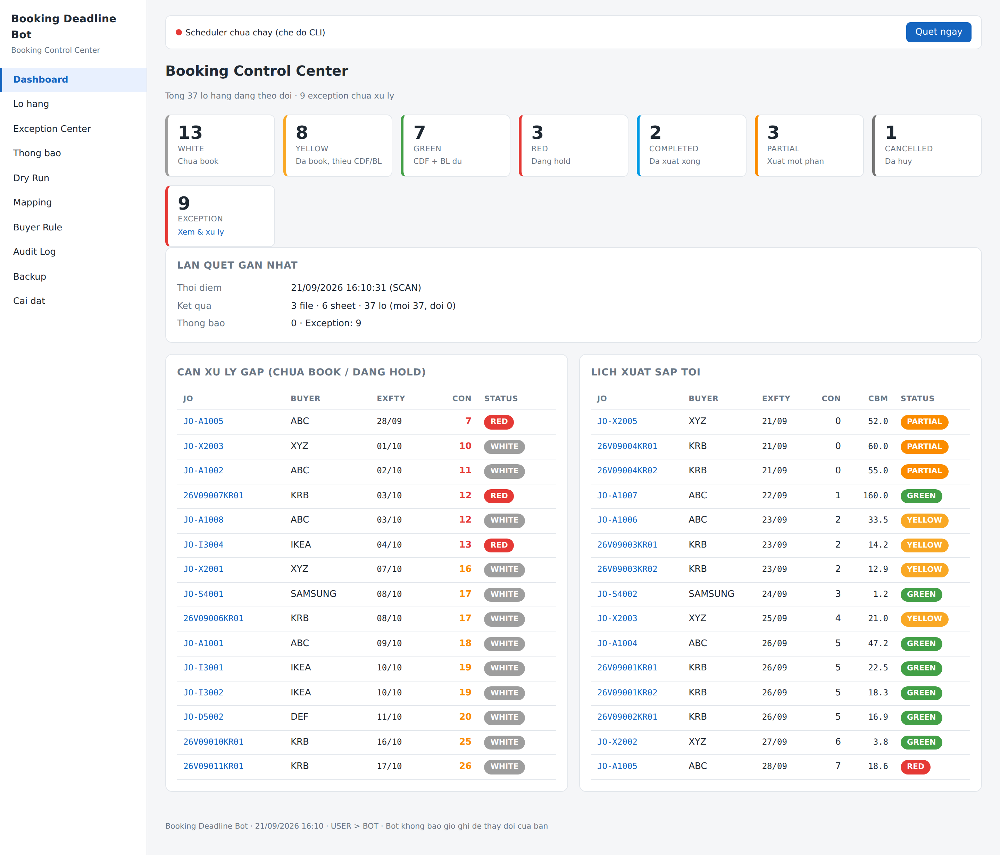
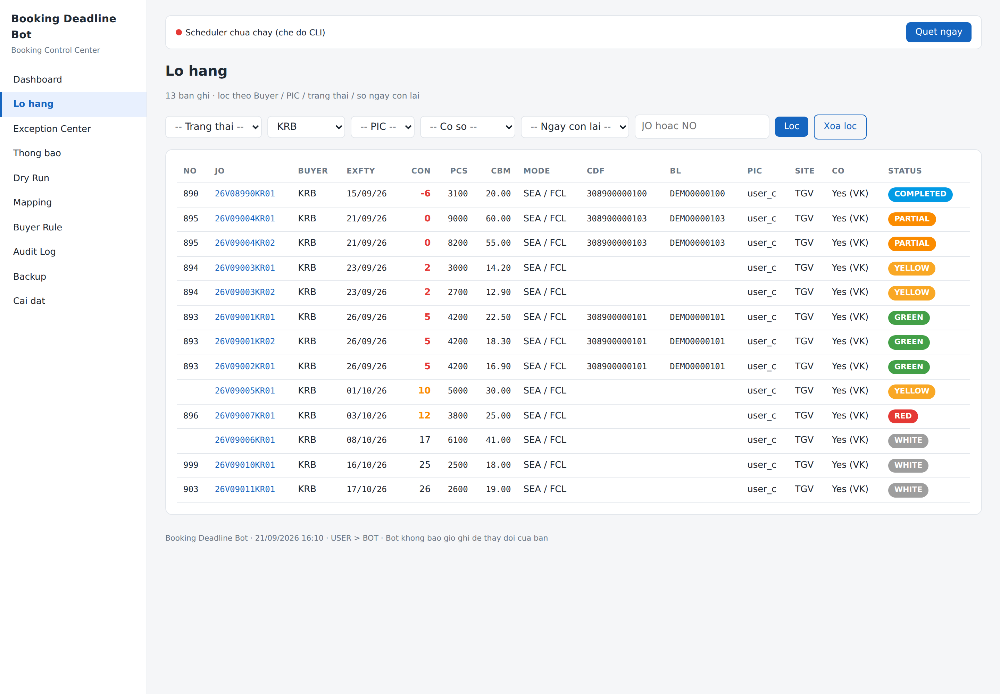
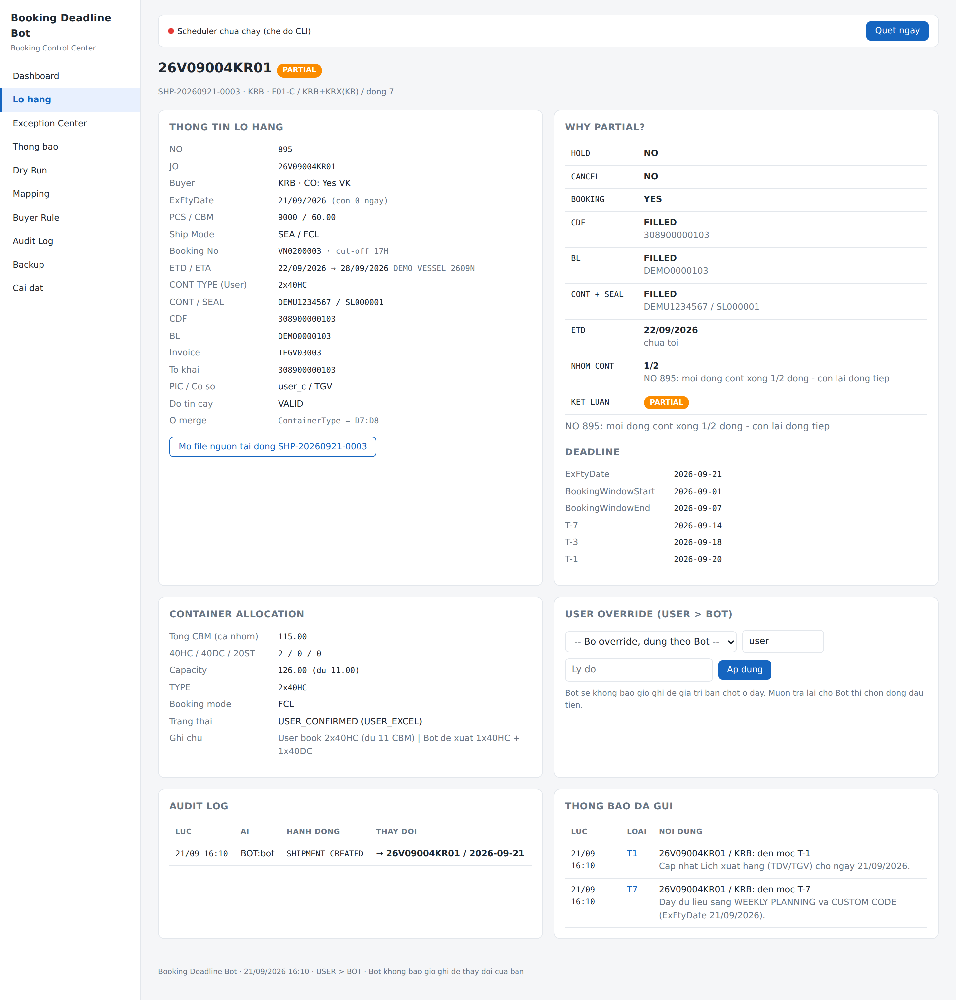
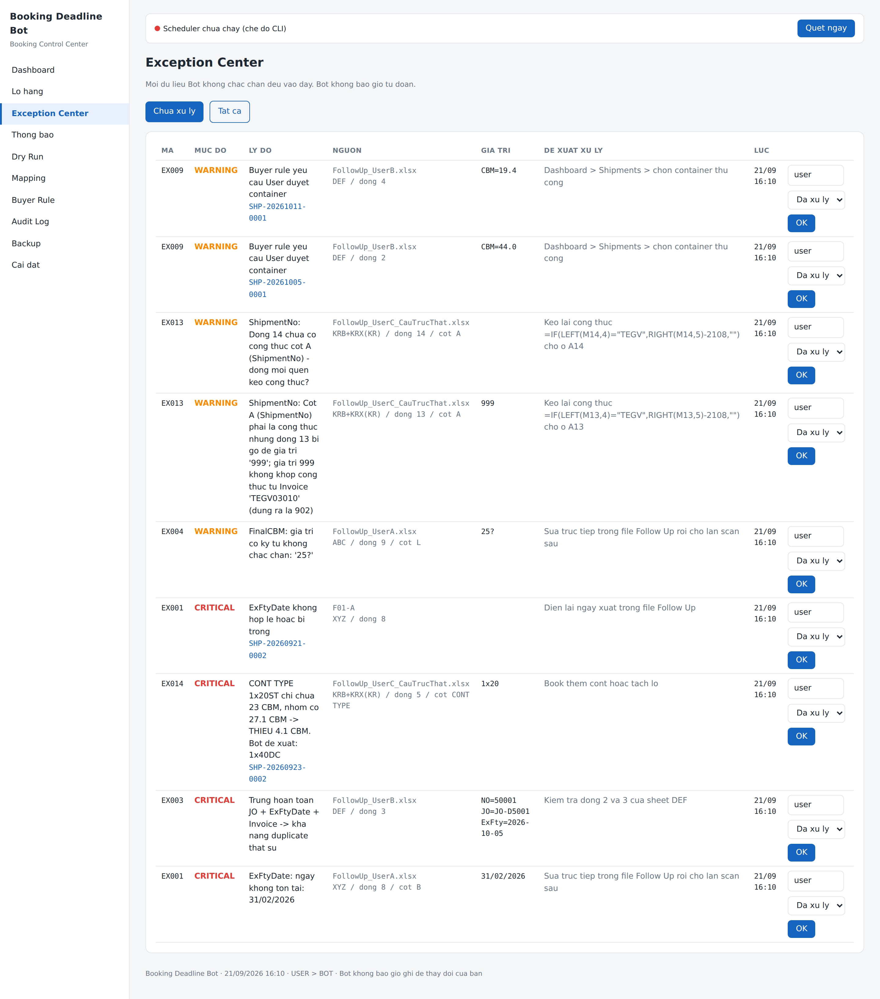

# Booking Deadline Bot

**Phần mềm tự động quản lý deadline booking xuất khẩu** — quét file Excel Follow Up, xác định tình trạng booking, tính container theo CBM, nhắc deadline đúng lúc và tự điền dữ liệu sang Weekly Planning / Custom Code / MM-Daily / Lịch xuất hàng.

Chạy ngầm trên Windows, có icon ở khay hệ thống và dashboard web tại `http://127.0.0.1:8765`.

```
Follow Up (mỗi người 1 file)
        ↓  quét mỗi 1–4 giờ
   Excel Scanner ──→ Database ──→ Rule Engine
        ↓                              ↓
   Exception Center            Booking / Container / Deadline
        ↓                              ↓
   Dashboard + Popup      Weekly Planning · Custom Code · Lịch xuất
```



---

## Nguyên tắc thiết kế

Đây **không phải** một macro Excel thông minh. Đây là hệ thống automation có **Database ở giữa**, Excel chỉ là nguồn và đích dữ liệu. Năm điều sau là kiến trúc lõi, không phải tính năng phụ:

| # | Nguyên tắc | Vì sao |
|---|---|---|
| 1 | **ShipmentID** là khóa, không dùng JO | Một JO có thể tách thành nhiều ngày xuất → là nhiều lô khác nhau |
| 2 | **Invoice / Tờ khai là quan hệ riêng** | 1 lô có thể 1 INV hoặc nhiều INV, 1 hoặc nhiều tờ khai |
| 3 | **Container Engine tính theo CBM** | Capacity phải `>=` CBM. Dư được phép, **thiếu thì không** |
| 4 | **USER > BOT** | Bạn sửa gì, Bot tôn trọng cái đó — kể cả những lần quét sau |
| 5 | **Version / Conflict Detection** | File đổi từ lúc Bot đọc → **STOP**, không bao giờ ghi đè |

---

## Đã chạy thử trên file Follow Up thật

Bot đã được chỉnh theo đúng file Follow Up đang dùng (1 sheet, **47 cột**, cột NO là công thức, CONT TYPE merge theo nhóm, 33 external link, 1495 defined name):

| | Kết quả |
|---|---|
| Nhận diện cột | **46/47 cột**, độ tin cậy 100% — không map nhầm GO ↔ HS CODE, CDF AMOUNT ↔ giá |
| NO = `RIGHT(INVOICE,5)-2108` | Đọc đúng số NO; tự tính lại nếu mất; báo khi bị gõ đè |
| 4 JO tách KR01/KR02, cùng invoice, CONT TYPE `1x20` merge `D2:D5` | 1 nhóm, **1 container** (không phải 4), 15.14 CBM ≤ 23 → khớp |
| CDF# + BL# + CONT + SEAL + ETD đã qua | `COMPLETED` |
| Sau khi Bot tô màu 2 lần | **79/81 phần của file giống từng byte**; công thức, giá trị NO, 1495 defined name, comment, merge còn nguyên |

Điểm quyết định: nếu dùng openpyxl để lưu, **cột NO đọc lại thành trống** và mất 2 defined name. Bot vì vậy ghi **lossless** — chỉ sửa đúng ô cần sửa. Chi tiết: [ARCHITECTURE.md § 5.7](docs/ARCHITECTURE.md#57-ghi-excel-lossless).

---

## Tính năng

**Đọc dữ liệu**
- Tự nhận diện sheet nào là Follow Up bằng **header**, không dựa vào tên sheet — kèm điểm confidence; không chắc thì hỏi bạn một lần rồi nhớ luôn
- Mỗi sheet Buyer viết header khác nhau vẫn đọc được: `ExFtyDate` / `EX FTY DATE` / `Export Factory Date` / `Ngày xuất` đều về một mối
- Chuẩn hóa ngày (7 định dạng), số (`1,234.56` và `1.234,56`), cờ Yes/No, ship mode
- Dữ liệu mập mờ (`CBM = "25?"`) → `NEED_REVIEW`, Bot **không tự đoán**
- Ô merge (CONT TYPE cho cả nhóm) được hiểu là **một** ô dùng chung
- Kiểm **toàn vẹn công thức**: ô bị gõ đè, dòng mới quên kéo công thức → `EX013`
- Đọc HOLD / CANCEL từ REMARK và **màu bạn tô tay** trong Excel

**Trạng thái booking**

| Màu | Trạng thái | Điều kiện |
|---|---|---|
| 🔴 Đỏ | `RED` | `HOLD = Yes` — **ưu tiên cao nhất**, kể cả khi đã đủ CDF + BL |
| ⚪ Trắng | `WHITE` | Chưa booking |
| 🟡 Vàng | `YELLOW` | Đã book nhưng thiếu CDF hoặc BL |
| 🟢 Xanh lá | `GREEN` | Đã book + CDF + BL đầy đủ (~80% hoàn thành) |
| 🔵 Xanh dương | `COMPLETED` | CDF + BL + CONT + SEAL + ETD đã qua |
| 🟠 Cam | `PARTIAL` | Cùng NO: có dòng đã đóng cont, có dòng chưa (tối nay 1 nửa, mai đóng tiếp) |
| ⚫ Xám | `CANCELLED` | Đã hủy booking, chờ gộp lô sau |

Mỗi trạng thái đều trả lời được câu hỏi **"Why Yellow?"** — bấm vào lô hàng là thấy từng bước suy luận.

**Container** — `40HC = 63` · `40DC = 53` · `20ST = 23` CBM, ưu tiên `40HC → 40DC → 20ST`

```
160 CBM  →  2 × 40HC + 1 × 40DC  →  capacity 179, dư 19 CBM  ✓
```

CONT TYPE bạn đã book (`1x20`, `2x40HC`…) được tôn trọng — Bot chỉ kiểm tra **đủ chỗ**: `1x20` cho 27.1 CBM → báo đỏ "THIẾU 4.1 CBM".

**Deadline**

| Mốc | Bot làm gì |
|---|---|
| T-20 → T-14 | Nhắc đặt booking (cửa sổ, không phải một ngày cố định) |
| T-14 trở đi | Chưa book → cảnh báo **CRITICAL** |
| T-7 | Tự điền **Weekly Planning** + **Custom Code** |
| T-3 | Kiểm tra `Inv · FinalQty · Carton · GW · CBM · Price · Discount` → `FOUND / MISSING / INVALID` |
| T-1 | Tự điền **Lịch xuất hàng** TDV (cơ sở 2) / TGV (cơ sở 1) |
| Hold | Nhắc lại mỗi 3 ngày (chỉnh được 1–7) |

Đổi `ExFtyDate` → toàn bộ deadline tính lại, ghi Audit Log, báo dòng cũ còn sót ở file đích.

**An toàn dữ liệu**
- **Ghi lossless**: chỉ sửa đúng ô cần sửa — công thức, giá trị tính sẵn, external link, defined name, comment giữ nguyên
- Không bao giờ ghi đè ô công thức; dòng mới trong file đích được **kéo công thức** như Excel
- Backup trước mỗi lần ghi, rollback 1 click
- File đang mở → thử lại 30s / 60s / 120s → Pending Queue, **không bao giờ ép ghi**
- UPSERT theo khóa nghiệp vụ → chạy 100 lần vẫn không tạo dòng trùng
- Không xóa giá trị bạn đã nhập tay bằng ô trống
- **Dry Run**: xem trước Bot sẽ làm gì mà không đụng vào file nào

**Giao diện**
- Icon khay hệ thống: `Last Scan 09:00 · Next Scan 12:00`, menu Quét ngay / Dry Run / Tạm dừng
- Popup Windows có ngữ cảnh đầy đủ + nút **Mở file nguồn** (nhảy đúng sheet, đúng dòng)
- Dashboard: Booking Control Center, Exception Center, Audit Log, Mapping, Buyer Rule, Backup

---

## Màn hình

<table>
<tr>
<td width="50%"><b>Danh sách lô hàng</b> — lọc theo Buyer · PIC · cơ sở · trạng thái · số ngày còn lại<br></td>
<td width="50%"><b>Chi tiết + "Why PARTIAL?"</b> — nhóm NO 895 mới đóng cont 1/2 dòng; CONT TYPE User book 2x40HC được kiểm đủ tải<br></td>
</tr>
<tr>
<td colspan="2"><b>Exception Center</b> — mọi thứ Bot không chắc chắn, kèm nguồn chính xác và đề xuất xử lý<br></td>
</tr>
</table>

---

## Cài nhanh (Windows)

```powershell
git clone https://github.com/<tài-khoản>/booking-deadline-bot.git
cd booking-deadline-bot
Set-ExecutionPolicy -Scope Process -ExecutionPolicy Bypass
.\scripts\install.ps1
```

Rồi:

```powershell
.\scripts\run.bat check            # kiểm tra nhận diện sheet & cột
.\scripts\run.bat scan --dry-run   # xem trước, không ghi file nào
.\scripts\run.bat scan             # chạy thật
.\scripts\run.bat run              # chạy ngầm + dashboard + tray icon
```

Chi tiết từng bước, kể cả OneDrive/SharePoint và lỗi thường gặp: **[docs/INSTALL.md](docs/INSTALL.md)**

### Chạy thử ngay không cần file thật

```powershell
.\scripts\run.bat sample     # tạo bộ 5 file Excel demo trong sample_data\
.\scripts\run.bat scan --dry-run
```

Bộ demo có 3 file Follow Up; `FollowUp_UserC_CauTrucThat.xlsx` mô phỏng **đúng cấu trúc file thật** (47 cột, công thức NO/FOB, CONT TYPE merge) với dữ liệu giả. Các tình huống khó được cài sẵn: JO tách 2 ngày xuất, JO tách KR01/KR02 xuất chung, dòng trùng, `CBM = "25?"`, ngày `31/02/2026`, HOLD trong REMARK, lô đã CANCEL, nhóm đóng cont dở dang, CONT TYPE thiếu chỗ, NO bị gõ đè, dòng quên kéo công thức, sheet `Summary` không phải Follow Up.

---

## Tài liệu

| File | Nội dung |
|---|---|
| **[docs/INSTALL.md](docs/INSTALL.md)** | Cài đặt từng bước, OneDrive/SharePoint, tự khởi động, đóng gói .exe, lỗi thường gặp |
| **[docs/USER_GUIDE.md](docs/USER_GUIDE.md)** | Hướng dẫn sử dụng hằng ngày: dashboard, override, exception, backup |
| **[docs/DEVELOPER_GUIDE.md](docs/DEVELOPER_GUIDE.md)** | Kiến trúc code, thêm file đích mới, thêm trạng thái, viết test |
| **[docs/DATA_MAPPING.md](docs/DATA_MAPPING.md)** | Data Mapping Specification — ánh xạ cột, quy tắc nghiệp vụ, output mapping |
| **[docs/ARCHITECTURE.md](docs/ARCHITECTURE.md)** | Sơ đồ luồng, schema database, quyết định thiết kế |
| **[docs/SRS_TRACEABILITY.md](docs/SRS_TRACEABILITY.md)** | Bảng đối chiếu từng mục SRS ↔ code ↔ test |

---

## Cấu hình

Ba file trong `config/` — sửa YAML, **không cần đụng vào code**:

| File | Dùng để |
|---|---|
| `config.yaml` | Đường dẫn 5 file Excel, chu kỳ quét, khung giờ, deadline, container, màu |
| `field_mapping.yaml` | Data Dictionary: header Excel ↔ canonical field |
| `buyer_rules.yaml` | CO Yes/No, CO Form, quy tắc gom lô, container, cơ sở TDV/TGV |

```yaml
# config/config.yaml — ví dụ trỏ vào OneDrive
files:
  - id: "F01-A"
    role: "follow_up"
    path: "C:/Users/nam/OneDrive - Cong ty/Logistics/Follow Up - Nam.xlsx"
    owner: "user_a"
    write: true
```

---

## Công nghệ

Python 3.11 · openpyxl · SQLAlchemy 2 (SQLite, đổi sang SQL Server được) · APScheduler · FastAPI · pystray · winotify

Không dùng VBA làm nền tảng chính: hệ thống cần background service, scheduler, database, multi-user, audit, conflict detection, retry và exception management — VBA không gánh được những thứ này.

---

## Trạng thái phát triển

| Giai đoạn | Nội dung | Tình trạng |
|---|---|---|
| Phase 1 | Excel Scanner · Header Mapping · Shipment · Database | ✅ |
| Phase 2 | Container Allocation · Status Engine · User Override | ✅ |
| Phase 3 | Weekly Planning · Custom Code · MM-Daily · Lịch xuất · T-20…T-1 | ✅ |
| Phase 4 | Dashboard · Exception Center · Audit · Dry Run · Backup · Rollback | ✅ |
| Bổ sung | Outlook reader (cập nhật booking từ mail) | ⚠️ cần Windows + Outlook desktop |

**Trước khi dùng với dữ liệu thật:**
- File **Follow Up** đã khớp cấu trúc thật (47 cột) — chỉ cần trỏ đường dẫn và thêm buyer thật vào `config/buyer_rules.yaml`
- 4 file đích (`F02`–`F05`) vẫn dùng bộ tên cột suy từ SRS. Mở file thật, đối chiếu rồi sửa `SPEC.columns` trong `src/booking_bot/outputs/*.py` — xem [docs/DATA_MAPPING.md § 11](docs/DATA_MAPPING.md)

---

## Kiểm thử

```bash
pytest -q                                   # 182 test
pytest -q --cov=booking_bot                 # kèm coverage
```

`tests/test_real_structure.py` (41 test) chạy trên file giả lập **đúng cấu trúc 47 cột** của Follow Up thật — công thức, ô merge, dữ liệu gõ đè, dòng thiếu công thức — và chứng minh ghi lossless.

Bộ test bám sát **tiêu chí nghiệm thu SRS mục 73**: không ghi đè User · không tạo duplicate khi chạy nhiều lần · không mất dữ liệu khi file bị khóa · `160 CBM → 2×40HC + 1×40DC` · RED luôn thắng · User override thắng Bot · đủ T-20/T-7/T-3/T-1.

---

## Giấy phép

MIT — xem [LICENSE](LICENSE).
