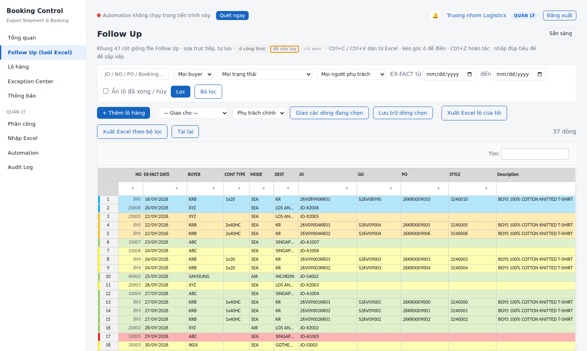

# Booking Control

**Web nội bộ quản lý Export Shipment & Booking** cho bộ phận logistics xuất khẩu — thay cho việc mỗi người tự theo dõi một file Excel Follow Up.

- Lưới **Follow Up 47 cột giống hệt file Excel** (sửa trực tiếp, dán từ Excel, kéo điền, lọc, sắp xếp, cố định cột, công thức NO / 95% FOB / CDF AMOUNT / TSN AMOUNT tính đúng như Excel).
- **Phân quyền** Quản trị / Quản lý / Người dùng (+ Chỉ xem), đăng nhập bằng tài khoản riêng.
- **Quản lý phân công** lô hàng cho từng người phụ trách (giao lẻ, giao hàng loạt theo Buyer / Forwarder / ngày EX-FACT / Mode, người dự phòng, lịch sử).
- **Xuất Excel** từ dữ liệu trên web: *lô của tôi* hoặc *theo bộ lọc* → mỗi Buyer một sheet, giữ đúng 47 cột và công thức.
- **Automation Engine** chạy nền trên máy chủ (không có "Bot"): quét Follow Up, tính trạng thái, nhắc deadline D-20 → D-1, phân bổ container, ghi Weekly Planning / HS Code / MM Daily / Lịch xuất hàng, đọc mail Outlook.

Chạy trên **một máy Windows làm máy chủ nội bộ**; đồng nghiệp mở bằng trình duyệt qua mạng LAN. Không cần Internet, không cần cài gì trên máy người dùng.



---

## Kiến trúc một trang

```
  Trình duyệt (Chrome/Edge)          MÁY CHỦ NỘI BỘ (Windows)
  ─────────────────────────          ─────────────────────────────────────────────────
  Đăng nhập  ─────────────────────▶  Web (FastAPI) ── phân quyền ở backend ──┐
  Lưới Follow Up 47 cột ◀── JSON ──  API lưu tự động + optimistic lock      │
  Phân công / Exception / Export                                             ▼
                                     Database (SQLite / SQL Server / PostgreSQL)
                                          ▲                          │
  File Follow Up Excel (OneDrive) ──▶ Automation Engine (APScheduler)│
  Outlook desktop ─────────────────▶  followup_scan · notification_dispatch · outlook_scan
                                      excel_write_retry · housekeeping  (ghi JobRun)
                                          │
                                          ▼
                     Weekly Planning · Custom Code · MM Daily · Lịch xuất (ghi lossless)
```

Nguyên tắc: **Database là trung tâm**, Excel chỉ còn vai trò nhập / xuất / tương thích. Dữ liệu người dùng sửa trên web luôn thắng dữ liệu tự động (**USER > AUTOMATION**); nếu file Excel sau đó đổi khác, hệ thống giữ giá trị web và đưa vào Exception Center để Quản lý quyết định.

---

## Tính năng theo vai trò

| | Quản trị | Quản lý | Người dùng | Chỉ xem |
|---|:-:|:-:|:-:|:-:|
| Xem lô hàng | tất cả | tất cả | lô được giao | tất cả |
| Sửa trên lưới Follow Up | ✓ | ✓ | lô được giao, theo quyền từng cột | – |
| Thêm lô hàng mới | ✓ | ✓ | ✓ (tự nhận phụ trách) | – |
| Giao / giao lại / giao hàng loạt | ✓ | ✓ | – | – |
| Xử lý Exception, duyệt xung đột Excel ↔ web | ✓ | ✓ | – | – |
| Xuất Excel | tất cả / theo lọc | tất cả / theo lọc | lô của mình | tất cả / theo lọc |
| Nhập file Follow Up (upload) | ✓ | ✓ | – | – |
| Automation: quét ngay, xem lịch sử job | ✓ | ✓ | – | – |
| Người dùng, mapping, buyer rule, cài đặt, backup | ✓ | – | – | – |

Quyền **từng cột** (Field Ownership Matrix) nằm trong [`config/followup_template.yaml`](config/followup_template.yaml): ví dụ Người dùng sửa được CBM, BOOKING NO, CONT, SEAL…; sửa BUYER / EX-FACT DATE thì được nhưng tạo mục "Quản lý xem lại"; cột công thức chỉ xem; NO chỉ Quản lý được ghi đè.

---

## Cài đặt nhanh (Windows)

```powershell
git clone https://github.com/<tài-khoản>/booking-control.git C:\Tools\booking-control
cd C:\Tools\booking-control
Set-ExecutionPolicy -Scope Process -ExecutionPolicy Bypass
.\scripts\install.ps1            # tạo .venv, cài thư viện, tạo config, tạo Admin, dữ liệu demo
.\scripts\run.bat run            # chạy web + Automation
```

Mở <http://127.0.0.1:8765>, đăng nhập `admin`. Muốn đồng nghiệp dùng chung: đặt `web.host: "0.0.0.0"`, chạy `.\scripts\open_firewall.ps1` (quyền Administrator), gửi họ địa chỉ `http://<IP-máy-chủ>:8765`.

Chi tiết từng bước, cấu hình file Excel thật, chạy nền khi khởi động Windows, sao lưu: **[docs/INSTALL.md](docs/INSTALL.md)**.

---

## Tài liệu

| Tài liệu | Dành cho |
|---|---|
| [INSTALL.md](docs/INSTALL.md) | Cài đặt, máy chủ LAN, tạo tài khoản, trỏ file Excel thật, chạy nền, nâng cấp từ v1 |
| [USER_GUIDE.md](docs/USER_GUIDE.md) | Người dùng & Quản lý: lưới Follow Up, phân công, xuất/nhập Excel, trạng thái màu, deadline |
| [DEVELOPER_GUIDE.md](docs/DEVELOPER_GUIDE.md) | Lập trình viên: cấu trúc mã, thêm cột / công thức / quyền / job, test, đóng gói |
| [ARCHITECTURE.md](docs/ARCHITECTURE.md) | Kiến trúc, database, các quyết định thiết kế |
| [DATA_MAPPING.md](docs/DATA_MAPPING.md) | 47 cột Follow Up ↔ trường chuẩn ↔ file đích |
| [SRS_TRACEABILITY.md](docs/SRS_TRACEABILITY.md) | Đối chiếu từng yêu cầu SRS ↔ mã nguồn ↔ test |

---

## Dòng lệnh

```powershell
.\scripts\run.bat run                      # web + Automation (chế độ hằng ngày)
.\scripts\run.bat run --host 0.0.0.0       # mở cho mạng LAN
.\scripts\run.bat check                    # kiểm tra file, nhận diện sheet, mapping cột
.\scripts\run.bat scan --dry-run           # xem trước một lần quét, không ghi file
.\scripts\run.bat user add nam.nguyen --role manager
.\scripts\run.bat user passwd nam.nguyen   # đặt lại mật khẩu
.\scripts\run.bat user list
.\scripts\run.bat backups F02              # liệt kê / khôi phục bản sao lưu file đích
```

---

## Công nghệ

Python 3.11 · FastAPI + Jinja2 · SQLAlchemy 2 (SQLite mặc định; SQL Server / PostgreSQL qua `database.url`) · APScheduler · openpyxl (đọc) + lxml (ghi Excel lossless, không phá công thức / định dạng / link) · Jspreadsheet CE 4 (MIT, đóng gói sẵn để chạy offline) · pytest (≈230 test) · GitHub Actions (Windows + Ubuntu).

Vì sao không dùng Celery/Redis như SRS gợi ý: Celery không hỗ trợ Windows chính thức và cần thêm dịch vụ Redis. Với quy mô một phòng logistics (vài nghìn lô), APScheduler chạy trong tiến trình máy chủ là đủ; mỗi job vẫn có Job ID, thời gian, trạng thái, lỗi, số lần thử lại như SRS yêu cầu. Khi cần mở rộng, các job nằm gọn trong `scheduler.py` để chuyển sang hàng đợi riêng.

---

## Bảo mật & dữ liệu

- Mật khẩu băm PBKDF2-SHA256; cookie phiên `HttpOnly` + `SameSite=Lax`; CSRF token cho mọi thao tác ghi; khóa tạm khi sai mật khẩu nhiều lần.
- Phân quyền kiểm tra ở **backend** — kể cả xuất Excel (người dùng yêu cầu xuất "tất cả" vẫn chỉ nhận lô của mình).
- Không xóa dữ liệu nghiệp vụ: lô hàng chỉ **lưu trữ**, tài khoản chỉ **khóa**; mọi thay đổi vào Audit Log (ai, lúc nào, giá trị cũ → mới).
- Không đưa file Excel thật / mã buyer thật lên GitHub: `config/config.yaml`, `config/buyer_rules.yaml`, `data/`, `sample_data/` đã nằm trong `.gitignore`. Dữ liệu demo hoàn toàn giả lập.

## Giấy phép

MIT — xem [LICENSE](LICENSE). Thư viện bên thứ ba đóng gói trong `web/static/vendor/` giữ giấy phép MIT gốc.
