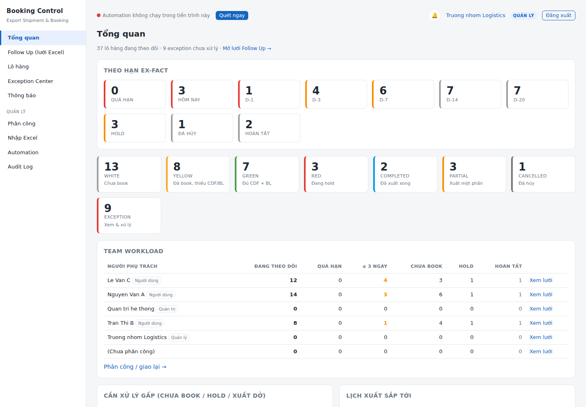
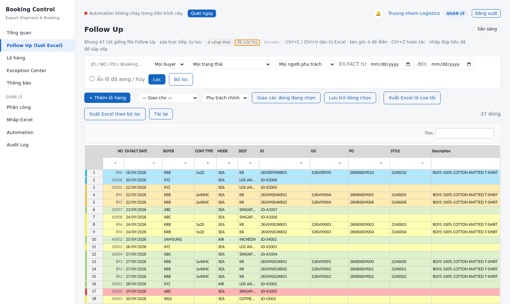
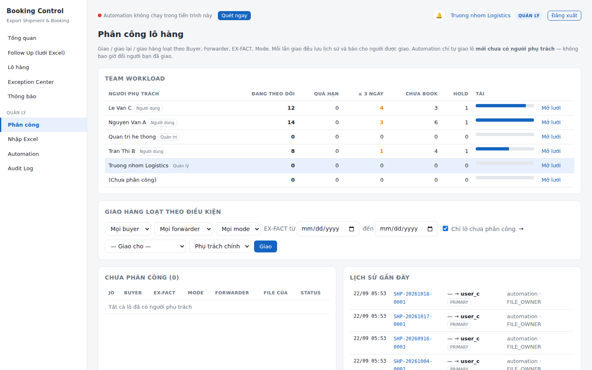

# Hướng dẫn sử dụng

Dành cho **Người dùng** (nhân viên booking) và **Quản lý**. Phần dành riêng cho Quản lý có đánh dấu 👔.

Mở trình duyệt Chrome / Edge, vào địa chỉ Admin gửi (ví dụ `http://192.168.1.20:8765`), đăng nhập bằng tài khoản của bạn.

---

## 1. Một ngày làm việc

| Lúc | Hệ thống làm | Bạn làm |
|---|---|---|
| Đầu giờ | Automation đã quét Follow Up, tính trạng thái, xếp lịch nhắc | Mở **Tổng quan**: xem ô *Quá hạn / Hôm nay / D-1 / D-3* |
| Trong ngày | Quét lại mỗi 3 giờ (09:00, 12:00, 15:00…); chuông 🔔 báo việc gấp | Làm việc trên **Follow Up (lưới Excel)**: nhập booking, CDF, BL, CONT, SEAL… |
| T-7 trước EX-FACT | Tự điền Weekly Planning + Custom Code | Kiểm tra HS Code, CO |
| T-3 | Báo đích danh trường còn thiếu (Carton, GW…) | Bổ sung |
| T-1 | Tự điền Lịch xuất hàng TDV/TGV | — |
| Cuối ngày | — | **Xuất Excel lô của tôi** nếu cần gửi đi |

**Tổng quan** của Người dùng chỉ đếm lô được giao cho bạn. 👔 Quản lý thấy thêm **Team Workload**: mỗi người đang giữ bao nhiêu lô, bao nhiêu quá hạn, bao nhiêu ≤ 3 ngày.

---

## 2. Tài khoản

- Lần đầu đăng nhập bằng **mật khẩu tạm** Admin gửi → hệ thống bắt đổi mật khẩu (≥ 8 ký tự, có chữ và số).
- **Tài khoản của tôi** (bấm tên ở góc phải): đổi mật khẩu, họ tên, email, bấm *Bật thông báo trên màn hình* để nhận Desktop Notification khi tab web đang mở.
- Tích *Ghi nhớ trên máy này* khi đăng nhập để không phải nhập lại trong 14 ngày (chỉ dùng trên máy cá nhân).
- Sai mật khẩu 5 lần → khóa tạm 10 phút. Quên mật khẩu → nhờ Admin *Đặt lại MK*.

---

## 3. Lưới Follow Up — làm việc như Excel

Menu **Follow Up (lưới Excel)**. Khung 47 cột đúng thứ tự file Follow Up (NO, EX-FACT DATE, BUYER, CONT TYPE, MODE, DEST, JO … CONT, SEAL, REMARK); cột A–J cố định khi cuộn ngang giống file thật. Ba cột cuối **PHỤ TRÁCH / TRẠNG THÁI / HẠN** do hệ thống điền.

### Thao tác

| Muốn | Làm |
|---|---|
| Sửa một ô | Chọn ô rồi gõ (hoặc nhấp đúp), Enter để xong |
| Dán từ Excel | Copy vùng ô trong Excel → chọn ô đầu trên lưới → `Ctrl + V` |
| Sao chép sang Excel | Chọn vùng → `Ctrl + C` → dán vào Excel |
| Điền nhanh xuống dưới | Kéo **góc dưới-phải** của ô (fill handle) như Excel |
| Hoàn tác / làm lại | `Ctrl + Z` / `Ctrl + Y` (thay đổi hoàn tác cũng được lưu) |
| Sắp xếp | Nhấp đúp tiêu đề cột, hoặc chuột phải → *Sắp xếp tăng / giảm* |
| Lọc theo giá trị một cột | Bấm ô ▾ ngay dưới tiêu đề cột |
| Tìm nhanh trên lưới | Ô **Tìm** phía trên lưới |
| Lọc từ máy chủ | Thanh lọc phía trên: JO/NO/PO/Booking, Buyer, Trạng thái, Người phụ trách 👔, khoảng EX-FACT, *Ẩn lô đã xong / hủy* → **Lọc** |
| Xem vì sao lô có màu đó | Chuột phải → **Mở chi tiết lô hàng (Why?)** |
| Chọn nhiều dòng | Bấm số thứ tự dòng bên trái, giữ `Shift` / `Ctrl` |

### Tự lưu

Không có nút *Lưu*. Mỗi thay đổi được gom lại ~0,6 giây rồi gửi lên máy chủ; góc phải hiện **Đang lưu… → Đã lưu ✓**. Máy chủ kiểm quyền từng ô, tính lại công thức và trạng thái, rồi trả về dòng chuẩn — màu dòng đổi ngay.

- Ô sai kiểu (gõ chữ vào CBM, ngày không hợp lệ) → thanh vàng báo lỗi, ô trở về giá trị cũ.
- Hai người cùng sửa một dòng → người lưu sau nhận thông báo *vừa được người khác cập nhật*, dòng tải lại bản mới nhất — **không ai ghi đè ai**.
- Đang lưu mà đóng tab → trình duyệt hỏi lại.

### Ký hiệu ô

| Ô | Nghĩa |
|---|---|
| *chữ nghiêng xám* | **Cột công thức** — tự tính giống Excel: `NO = IF(LEFT(INVOICE,4)="TEGV", RIGHT(INVOICE,5)-2108, "")`, `95% FOB = ROUND(100% FOB × 0,95; 2)`, `CDF AMOUNT = 95% FOB × Final Qty`, `TSN AMOUNT = 100% FOB × Final Qty` |
| viền cam | Ô đã **sửa tay trên web** — Automation / file Excel không ghi đè ô này |
| chữ xám nhạt | Bạn **chỉ xem**, không sửa được |
| viền đỏ | Cột bắt buộc đang trống (JO, EX-FACT DATE, BUYER) |

### Bạn được sửa cột nào (Người dùng)

| Nhóm cột | Quyền |
|---|---|
| CONT TYPE, MODE, DEST, GO, PO, STYLE, Description, INVOICE, Final Qty, CTNS, G.W, CBM, ETD, ETA, Color, BOOKING NO, CURRENCY, HS CODE, CDF#, BL#, VESSEL, E-SHIPMENT, TERM, VAT…, SQ, Booking date, Closing time, PORT/WH, CO…, CONT, SEAL, REMARK | ✓ sửa |
| EX-FACT DATE, BUYER, JO, ORDER QTY, 100% FOB | sửa được nhưng tạo mục **EX016 "cần Quản lý xem lại"** |
| NO | chỉ Quản lý ghi đè (xóa trắng → công thức chạy lại) |
| 95% FOB, CDF AMOUNT, TSN AMOUNT | công thức — không ai sửa tay, sửa 100% FOB / Final Qty thì tự tính |

Admin đổi được bảng quyền này trong `config/followup_template.yaml`.

### Thêm lô hàng mới

Nút **+ Thêm lô hàng** → nhập JO, EX-FACT DATE, BUYER (bắt buộc), MODE, CBM, PO → **Thêm**. Dòng mới xuất hiện đầu lưới, gắn nhãn *web*, bạn là người phụ trách (👔 Quản lý chọn được người nhận). Hệ thống từ chối nếu đã có lô cùng JO + EX-FACT DATE.

### HOLD / CANCEL

Gõ vào REMARK như trong Excel: `HOLD - chờ khách duyệt mẫu` → dòng chuyển **đỏ**; `CANCEL booking, gộp lô sau` → **xám**; `UNHOLD` / `release hold` không bị hiểu là hold. Hoặc mở chi tiết lô → **Chốt trạng thái** kèm lý do.

---

## 4. Màu trạng thái

| Màu | Trạng thái | Nghĩa | Việc cần làm |
|---|---|---|---|
| ⚪ | WHITE | Chưa booking | Đặt booking, nhất là khi còn dưới 14 ngày |
| 🟡 | YELLOW | Đã book, thiếu CDF hoặc BL | Theo dõi chứng từ |
| 🟢 | GREEN | Đủ CDF + BL (~80%) | Theo dõi tới ngày xuất |
| 🔴 | RED | Đang HOLD | Xử lý lý do; nhắc lại mỗi 3 ngày |
| 🔵 | COMPLETED | Đã xuất xong: CDF + BL + CONT + SEAL (hàng container) + ETD đã qua | — |
| 🟠 | PARTIAL | Cùng NO có dòng đã đóng cont, có dòng chưa ("xuất tối nay một nửa, mai đóng tiếp") | Đóng tiếp phần còn lại |
| ⚫ | CANCELLED | Đã hủy booking | Đặt lại hoặc gộp lô sau |

**Đỏ luôn thắng**: đủ CDF + BL nhưng đang HOLD vẫn là đỏ. Trang chi tiết lô có bảng **Vì sao …?** liệt kê từng điều kiện đã xét.

Bạn chốt trạng thái khác với hệ thống (ví dụ khách báo hold qua điện thoại) → trang chi tiết → **Chốt trạng thái** + lý do. Automation không đổi lại (**USER > AUTOMATION**); chọn *Theo Automation* để trả quyền.

Nếu vẫn dùng file Excel song song: **tô màu tay** trong Excel cũng được hiểu là chốt trạng thái (tô đỏ = hold; tô lại đúng màu hệ thống = trả quyền; màu lạ = hệ thống không tô đè dòng đó).

---

## 5. Deadline & thông báo

| Mốc (tính từ EX-FACT) | Nhắc |
|---|---|
| D-20 → D-14 | "Chưa booking" (cảnh báo vàng) |
| < D-14 mà chưa book | "TRỄ BOOKING" (CRITICAL) |
| D-7 | Tự điền Weekly Planning + Custom Code (HS Code) |
| D-3 | Báo trường còn thiếu / sai: Carton, GW, CBM, HS Code… |
| D-1 | Tự điền Lịch xuất hàng TDV/TGV |
| Đang HOLD | Nhắc lại mỗi 3 ngày tới khi hết hold |

Thông báo gửi cho **người phụ trách lô** (thông báo chung không có người phụ trách → Quản lý). Xem ở 🔔 và menu **Thông báo**; bật Desktop Notification để trình duyệt tự bật lên. Ngoài khung 08:00–16:00 hệ thống vẫn quét nhưng dồn thông báo tới giờ làm. Admin có thể bật thêm email cho mức CRITICAL.

---

## 6. Container

Cột CONT TYPE là container **bạn** book; hệ thống không đổi, chỉ kiểm tra đủ chỗ (40HC = 63 CBM, 40DC = 53, 20ST = 23; cả nhóm cùng NO tính một lần):

| Bạn ghi | Tổng CBM nhóm | Hệ thống báo |
|---|---|---|
| `1x20` | 15,14 | Khớp — dư 7,86 CBM |
| `1x20` | 27,1 | **THIẾU 4,1 CBM** — `EX014` CRITICAL |
| `2x40HC` | 115 | Đủ chỗ (kèm phương án hệ thống tính: 1x40HC + 1x40DC) |

Đọc được: `1x20`, `1x40`, `1x40HC`, `1X40HQ`, `2x40HC+1x20`, `LCL`, `AIR`. Hàng AIR → TYPE = AC.

---

## 7. Xuất Excel

Trên lưới Follow Up:

- **Xuất Excel lô của tôi** — mọi lô bạn phụ trách (chính hoặc dự phòng). Tên file `ten-dang-nhap_Shipment_2026_09_22.xlsx`.
- 👔 **Xuất Excel theo bộ lọc** — đúng bộ lọc đang áp dụng (Buyer, trạng thái, người phụ trách, khoảng ngày…).

File xuất:

- **Mỗi Buyer một sheet** (tên tối đa 31 ký tự, trùng thì thêm `_2`, `_3`).
- **47 cột đúng thứ tự Follow Up** + các cột hệ thống ở cuối: ASSIGNED USER, BACKUP OWNER, FORWARDER, BOOKING STATUS, SHIPMENT STATUS, DEADLINE STATUS, LAST UPDATED.
- Cột NO, 95% FOB, CDF AMOUNT, TSN AMOUNT là **công thức Excel thật** (sửa INVOICE / giá trong file là tự tính lại); ô đã sửa tay thì ghi giá trị.
- Cố định cột A–J, bật AutoFilter, cột NO tô vàng, dòng tô màu theo trạng thái, CONT TYPE merge theo nhóm như file gốc.

Quyền kiểm tra ở máy chủ: Người dùng chỉ bao giờ nhận được lô của mình, dù sửa đường link.

---

## 8. 👔 Phân công lô hàng

### Tự động

Lô **mới** chưa có người phụ trách được giao theo thứ tự: rule trong `config.yaml › assignment.rules` (theo Buyer / Forwarder / Mode / cơ sở) → chủ file Follow Up (`owner` của file) → để *Chưa phân công*. Automation **không bao giờ** đổi người mà Quản lý đã giao.

### Trên lưới

Chọn các dòng (bấm số thứ tự bên trái, giữ Shift) → chọn người ở ô **— Giao cho —**, chọn *Phụ trách chính* hoặc *Dự phòng* → **Giao các dòng đang chọn**.

### Trang Phân công

- **Team Workload**: số lô, quá hạn, ≤ 3 ngày, chưa book, hold của từng người — thanh *Tải* để cân việc.
- **Giao hàng loạt theo điều kiện**: Buyer + Forwarder + Mode + khoảng EX-FACT (+ *chỉ lô chưa phân công*) → người nhận → **Giao**.
- Danh sách lô **Chưa phân công** và **Lịch sử** gần đây.

Người được giao nhận **một** thông báo gom nhóm ("Bạn được giao 12 lô hàng"). Mọi lần giao / giao lại lưu ở tab *Lịch sử phân công* của từng lô và Audit Log.

**Người dự phòng** thấy và sửa được lô như người phụ trách chính — dùng khi nghỉ phép.

---

## 9. 👔 Nhập file Follow Up

Menu **Nhập Excel**: chọn file `.xlsx` + người phụ trách → **Xem trước** (bao nhiêu sheet, bao nhiêu lô *THÊM MỚI* / *CẬP NHẬT*) → **Nhập**. Nhập lại cùng file cho cùng người sẽ cập nhật, không tạo trùng. File gốc không bị sửa. Lỗi dữ liệu (thiếu ngày, công thức bị gõ đè…) vào Exception Center.

Dùng khi chuyển hẳn sang làm trên web: nhập file Follow Up hiện tại của từng người một lần, sau đó làm trên lưới.

---

## 10. Exception Center

Mọi thứ hệ thống không chắc chắn đều vào đây — hệ thống **không tự đoán**. Người dùng thấy exception của lô mình; Quản lý xử lý.

| Mã | Nghĩa |
|---|---|
| EX001 | Thiếu / sai EX-FACT DATE |
| EX002 / EX008 | Buyer chưa có rule |
| EX003 | Nghi trùng lô |
| EX004 | CBM không hợp lệ |
| EX005 | Sheet chưa chắc là Follow Up — xác nhận ở Mapping |
| EX006 | Không tìm thấy / không đọc được file |
| EX007 | Có người sửa file trong lúc hệ thống đang ghi |
| EX010 | Header Excel đổi, mapping không khớp |
| EX011 | Trường bắt buộc bị trống |
| EX012 | Không ghi được file đích |
| EX013 | Công thức Excel bị gõ đè / thiếu / sai mẫu |
| EX014 | CONT TYPE không đủ chỗ hoặc không đọc được |
| **EX015** | **File Excel khác giá trị đã sửa trên web** — hệ thống đang giữ giá trị web. Quản lý bấm *Giữ giá trị web* hoặc *Lấy giá trị Excel* |
| **EX016** | Người dùng sửa cột cần Quản lý xem lại (BUYER, EX-FACT DATE, JO, ORDER QTY, 100% FOB) |
| **EX017** | Forwarder cần xác nhận (nhiều rule khớp / khác với email) |

---

## 11. Forwarder

Theo `buyer_rules.yaml › forwarder_rules`: Buyer + Mode + Dest + Port → Forwarder. Một rule khớp → **AUTO_ASSIGNED**; nhiều rule → **NEED_CONFIRM** (không tự chọn); không có → **NOT_ASSIGNED**. Trang chi tiết lô → ô Forwarder → **Chốt forwarder** (trạng thái *MANUAL*, Automation không đổi nữa; để trống = quay lại theo rule).

---

## 12. 👔 Automation

Menu **Automation**: các tác vụ nền (quét Follow Up, phát thông báo, ghi lại file bị khóa, đọc Outlook, dọn dẹp) với lần chạy kế tiếp, nút **Chạy ngay**, và **lịch sử chạy** (Job ID, bắt đầu, kết thúc, trạng thái, số lần thử lại, lỗi). **Dry Run** cho xem trước một lần quét mà không ghi file nào. Admin tạm dừng / chạy tiếp được.

---

## 13. Hỏi nhanh

**Vẫn sửa file Excel Follow Up được không?** Được. Hệ thống vẫn quét file mỗi 3 giờ. Ô nào đã sửa trên web thì web thắng; nếu sau đó file Excel đổi ô đó thành giá trị khác → EX015 cho Quản lý quyết. Lời khuyên: mỗi cột nên sửa ở **một** nơi.

**Web có ghi ngược vào file Follow Up không?** Chỉ tô màu dòng theo trạng thái (lossless — không phá công thức, định dạng, link). Dữ liệu sửa trên web nằm trong database và trong file **Xuất Excel**.

**Tôi không thấy lô của đồng nghiệp?** Đúng quyền — Người dùng chỉ thấy lô được giao (chính hoặc dự phòng). Nhờ Quản lý giao dự phòng khi cần làm thay.

**Lỡ lưu trữ nhầm lô?** 👔 Mở chi tiết lô (tìm ở Audit Log) → **Bỏ lưu trữ**. Dữ liệu không bao giờ bị xóa.

**Máy chủ tắt thì sao?** Không vào được web, Automation dừng. Khi bật lại, hệ thống quét bù ngay và phát các thông báo đang chờ.
